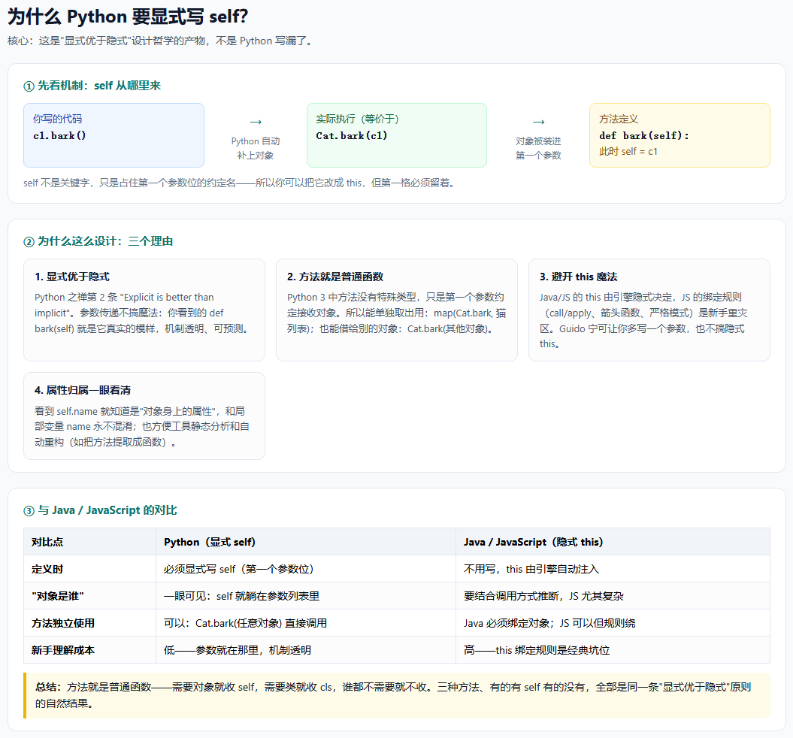
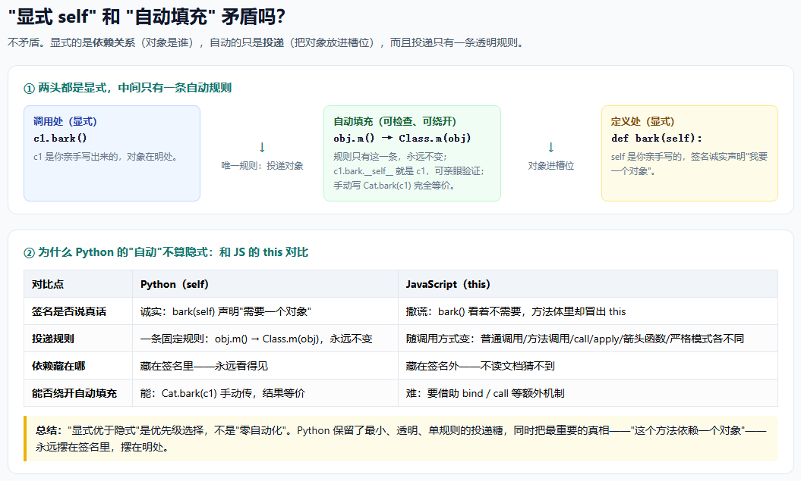
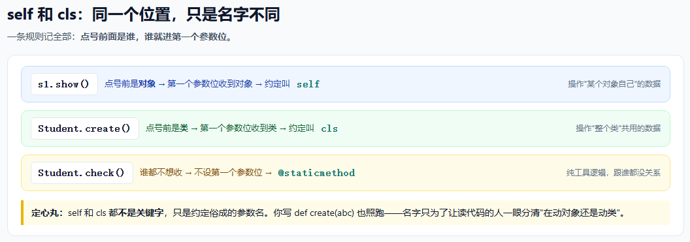
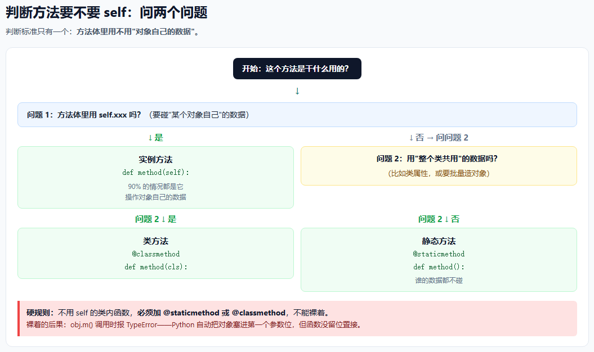
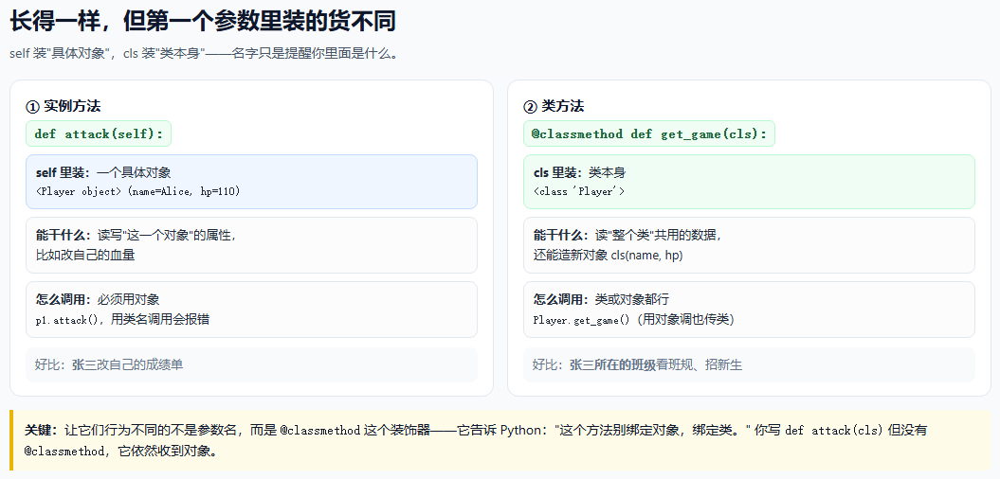
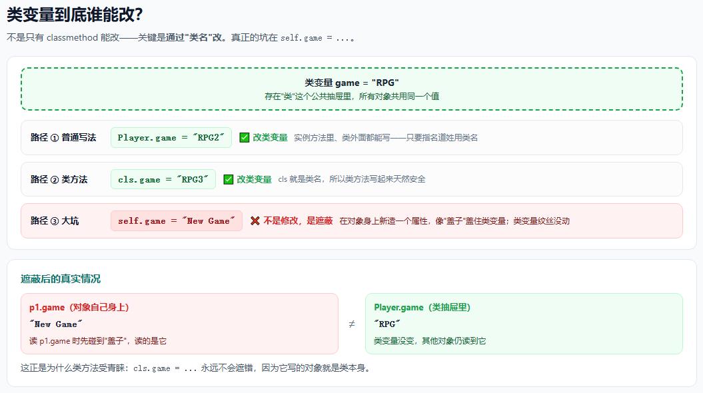
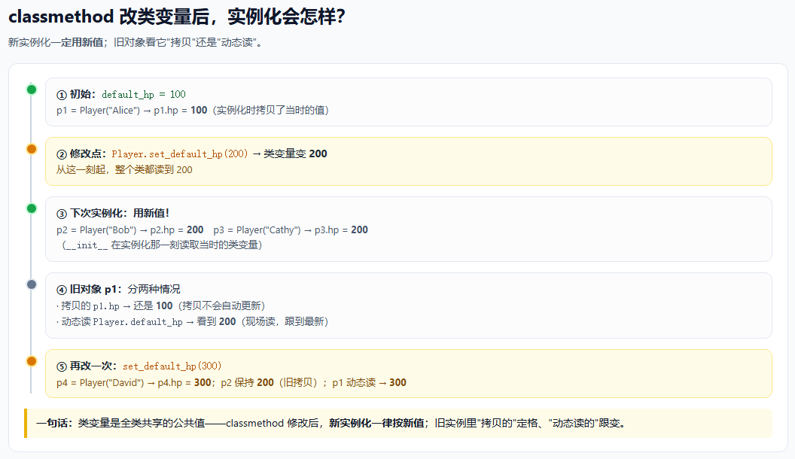

# Python 入门学习问答合集

> 一个零基础 Python 学习者的真实提问记录：从基础语法到面向对象（self / cls / 类变量）的逐步追问。
> 本文档包含全部问答；讲解配图在 [images/](images/) 目录，可运行示例代码在 [code/](code/) 目录。

---

## 目录

- 01 Python 基础语法入门
- 02 类与 self 入门
- 03 为什么 Python 要显式写 self？
- 04 "显式 self" 和 "自动填充" 矛盾吗？
- 05 cls 和 self 什么关系？
- 06 如何判断方法要不要 self？
- 07 实例方法和类方法看起来一样？
- 08 类变量到底谁能修改？
- 09 修改类变量后，下次实例化会怎样？

---

## 01 Python 基础语法入门

**问题：** 我是 Python 入门初学者，请写一份适合我学习的基础代码。

### 回答要点

用一份可运行的代码文件覆盖 Python 基础语法，共 10 节，从上到下按依赖顺序组织：

| 节 | 内容 |
|---|---|
| 1 | 变量与数据类型（str / int / float / bool） |
| 2 | 输入输出（input / print） |
| 3 | 运算符（算术、比较、逻辑） |
| 4 | 字符串（索引、切片、f-string） |
| 5 | 列表（增删改查、遍历） |
| 6 | 元组、字典、集合 |
| 7 | 条件判断 if / elif / else |
| 8 | 循环 for / while（含 break / continue） |
| 9 | 函数（定义、参数、返回值） |
| 10 | 综合小例子：简易成绩单程序 |

### 运行方式

```bash
python code/Python入门学习代码.py
```

直接打开：[code/Python入门学习代码.py](code/Python入门学习代码.py)

第 10 节会等待输入，输入 `done` 结束。

### 关键约定

- 注释（`#` 开头或三引号包裹）不会被运行，是给人看的说明；
- `input()` 拿到的永远是字符串，做数字运算前要先 `int()` / `float()` 转换；
- Python 用缩进表示代码块，同一个块内别混用空格和 Tab；
- 变量可以重新赋值，新值会覆盖旧值。

### 延伸练习

把第 10 节成绩单程序改一改：比如增加"不及格名单"输出，或允许输入小数成绩。

---

## 02 类与 self 入门

**问题：** 请再写一份关于类的学习代码，并解释为什么类中的方法参数有的有 self、有的没有。

### 回答要点

- **类 = 图纸**，**对象（实例）= 按图纸造出来的具体东西**；同一个类能造出很多个互不相干的对象；
- `__init__` 是构造方法，造对象时自动调用，用来给对象设置初始数据；
- **`self` 不是关键字**，只是约定俗成的参数名，代表"正在被操作的那个对象自己"；
- 三种方法的区别：
  - **实例方法**（写 `self`）：要用"某个对象自己的数据"（`self.xxx`）；
  - **类方法**（`@classmethod` + `cls`）：要用"整个类共用的数据"（类属性）；
  - **静态方法**（`@staticmethod`，不写）：谁的数据都不用，纯工具逻辑；
- 判断口诀：**见 self → 在动对象；见 cls → 在动类；都没有 → 谁都不动。**

### 代码

- [code/Python类与self学习代码.py](code/Python类与self学习代码.py)：8 节完整讲解，含"忘了写 self 的真实报错演示"；
- [code/this和self测试.py](code/this和self测试.py)：把 self 改名 this 的试验——证明 self 只是约定名。

### 关键实验

```python
class Cat:
    def __init__(this, name, age):   # 把 self 改成 this，照样能跑
        this.name = name
        this.age = age
```

如果**删掉第一个参数位**，会报：

```
TypeError: Cat.__init__() takes 2 positional arguments but 3 were given
```

"多出来的第 3 个参数"就是 Python 自动塞进来的对象自己——所以第一格必须留着，但名字随便起。

---

## 03 为什么 Python 要显式写 self？

**问题：** Python 为什么要显式设计 self 参数？

### 核心回答

这是 Python 设计哲学"**显式优于隐式**"（Explicit is better than implicit，Python 之禅第 2 条）的产物，不是写漏了：

1. **显式优于隐式**：`def bark(self)` 的签名说真话——这个方法需要对象，就摆在第一个参数位，机制透明、可预测；
2. **方法就是普通函数**：Python 3 中方法没有特殊类型，可以单独取出当函数用（`map(Cat.bark, 猫列表)`），也可以借给别的对象（`Cat.bark(其他对象)`）；
3. **避开 this 魔法**：Java/JS 的隐式 this 绑定规则复杂（call/apply、箭头函数、严格模式），是新手重灾区。Guido 宁可让你多写一个参数，也不搞隐式 this；
4. **属性归属一眼看清**：`self.name` 明确是对象属性，不会和局部变量 `name` 混淆，也方便工具静态分析和自动重构。

### 对比 Java / JavaScript

| 对比点 | Python（显式 self） | Java / JavaScript（隐式 this） |
|---|---|---|
| 定义时 | 必须显式写 self | 不用写，引擎自动注入 |
| "对象是谁" | 一眼可见 | 要结合调用方式推断 |
| 方法独立使用 | 可以：`Cat.bark(任意对象)` | Java 必须绑定对象；JS 规则绕 |
| 新手理解成本 | 低 | 高（this 是经典坑位） |



---

## 04 "显式 self" 和 "自动填充" 矛盾吗？

**问题：** 定义方法时要求显式写 self，调用时却又自动填充，这算不算隐式？两者矛盾吗？

### 核心回答

**不矛盾。显式的是"依赖关系"，自动的只是"投递"，且投递只有一条规则。**

- **调用处显式**：`c1.bark()` —— c1 是你亲手写出来的，对象在明处；
- **定义处显式**：`def bark(self)` —— 签名诚实声明"我要一个对象"；
- **中间自动**：`obj.m() → Class.m(obj)`，唯一一条规则，永远不变。

这个"自动"是**透明、可检查、可绕开**的：

- `c1.bark.__self__` 就是 c1，可以亲眼验证；
- 手动写 `Cat.bark(c1)` 完全等价——自动填充只是替你写了"你本来会写的那句"；
- 规则只有一条，没有任何上下文变化。

### 与 JS this 的本质差别

| 对比点 | Python（self） | JavaScript（this） |
|---|---|---|
| 签名是否说真话 | 诚实：`bark(self)` 声明"需要一个对象" | 撒谎：`bark()` 看着不需要，方法体里却冒出 this |
| 投递规则 | 一条固定规则，永远不变 | 随调用方式变（普通调用/方法调用/call/apply/箭头函数/严格模式） |
| 依赖藏在哪 | 藏在签名里——永远看得见 | 藏在签名外——不读文档猜不到 |
| 能否绕开自动填充 | 能：`Cat.bark(c1)` 手动传 | 难：要借助 bind / call |

**结论**："显式优于隐式"是优先级选择，不是"零自动化"。Python 保留了最小、透明、单规则的投递糖，同时把最重要的真相——"这个方法依赖一个对象"——永远摆在签名里。



---

## 05 cls 和 self 什么关系？

**问题：** 类方法里又出现 cls，它和 self 是什么关系？感觉很混乱。

### 核心回答

**它们不是两套机制，是同一个位置、同一个规则，只是名字不同。**

> 一条规则记全部：**点号前面是谁，谁就进第一个参数位。**

- `s1.show()` → 点号前是**对象** → 第一个参数位收到对象 → 约定叫 `self`；
- `Student.create()` → 点号前是**类** → 第一个参数位收到类 → 约定叫 `cls`；
- `Student.check()` → 谁都不想收 → 不设第一个参数位 → `@staticmethod`。

**定心丸：`self` 和 `cls` 都不是关键字**，只是约定俗成的参数名。你把 `def create(cls)` 写成 `def create(abc)` 也照跑——名字不同，纯粹是为了读代码时一眼分清"在动对象还是动类"。机器根本不在乎。

### 初学者行动指南

现阶段**只需要会写带 `self` 的实例方法**；`@classmethod` / `@staticmethod` 见到认识即可，等实际用到（比如"工厂方法"）再回来细学，一点都不迟。



---

## 06 如何判断方法要不要 self？

**问题：** 如何判断类中的方法需不需要 self？不用 self 的函数必须加 @staticmethod 吗？

### 核心回答

**判断标准只有一个：方法体里用不用"某个对象自己的数据"（`self.xxx`）。**

- 用了 → **实例方法**，写 `self`；
- 没用，但要用"整个类共用的数据"（类属性）→ **类方法**，`@classmethod` + `cls`；
- 什么都没用，纯靠参数算 → **静态方法**，`@staticmethod`，不写 self。

**不用 self 的类内函数必须加 @staticmethod 或 @classmethod 吗？——必须！** 不能裸着。

原因：Python 调用 `obj.m()` 时会自动把对象塞进第一个参数位。裸函数没有参数位接，直接报错（真实运行结果）：

```
TypeError: Wrong.hello() takes 0 positional arguments but 1 was given
```

而用 `Wrong.hello()`（类名调用）虽然能跑，但同一个函数两种调用行为不一样，是颗随时会踩的雷。

### 决策图



### 判断口诀

写方法前先问自己："我要碰对象的属性吗？" 碰 → 写 `self`；不碰 → 记得贴装饰器（碰类数据贴 `@classmethod`，啥也不碰贴 `@staticmethod`）。

### 代码

[code/判断方法要不要self.py](code/判断方法要不要self.py)：三种方法放在同一个类里对照，反例的真实报错也跑出来了。

---

## 07 实例方法和类方法看起来一样？

**问题：** 类方法和实例方法看起来几乎一样，它们的区别到底是什么？

### 核心回答

长得一样，但**第一个参数里装的货不同**。实际运行打印结果：

```
self = <__main__.Player object at 0x...>   ← self 里装的是"一个具体对象"
cls  = <class '__main__.Player'>           ← cls 里装的是"类本身"
```

| | 实例方法（self） | 类方法（cls） |
|---|---|---|
| 第一个参数里装 | 一个具体对象（有自己的属性） | 类本身 |
| 用什么调用 | 必须用对象：`p1.attack()`；用类名调用报错 | 类和对象都行：`Player.get_game()` |
| 能干什么 | 读写这个对象的属性 | 读类属性、造新对象（工厂） |
| 好比 | 张三改自己的成绩单 | 班级看班规、招新生 |

**关键：让它们行为不同的不是参数名，而是 `@classmethod` 这个装饰器**——它告诉 Python"别绑定对象，绑定类"。你写 `def attack(cls)` 但没有 `@classmethod`，它收到的依然是对象。

### 配图



### 代码

[code/self和cls装的是什么.py](code/self和cls装的是什么.py)：把 self / cls 直接打印出来看；并验证"类方法用对象调用时，装的仍然是类，不是那个对象"。

---

## 08 类变量到底谁能修改？

**问题：** 类变量只有用 classmethod 修饰的函数才能修改吗？普通实例方法改不了吗？

### 核心回答

**不对。类变量不是只有 classmethod 能改——任何函数都能改，关键是"通过类名改"：**

| 写法 | 结果 |
|---|---|
| `Player.game = "RPG2"`（实例方法里、类外面都能写） | ✅ 改类变量 |
| `cls.game = "RPG3"`（类方法里） | ✅ 改类变量（cls 就是类名） |
| `self.game = "New Game"`（实例方法里） | ❌ **不是修改，是"遮蔽"** |

**遮蔽（shadowing）陷阱**：`self.game = ...` 不是在改类变量，而是在对象身上**新造一个属性**，像盖子一样把类变量盖住。之后 `p1.game` 读到的是盖子，`Player.game` 读到的才是真值——两个还不一样，特别容易出 bug：

```python
p1.wrong_try()       # 方法体里写了 self.game = "New Game"
p1.game              # "New Game"   ← 读到自己身上的盖子
Player.game          # "RPG"        ← 类变量纹丝没动
```

所以准确的说法是：**classmethod 不是"唯一能改类变量的函数"，而是"永远改不错的函数"**——因为它写的对象就是类本身，永远不会遮错。

### 配图



### 代码

[code/类变量到底谁能改.py](code/类变量到底谁能改.py)：4 种改法逐一演示，包含遮蔽陷阱、正确改法、类外直接改。

---

## 09 修改类变量后，下次实例化会怎样？

**问题：** 用 classmethod 修改类变量后，下次实例化会按照新修改后的值进行吗？

### 核心回答

**会！新实例化一定用新值。** 因为 `__init__` 是在"实例化那一刻"执行的，读取的是当时的类变量。

但已存在的旧实例分两种情况：

| 旧对象怎么用类变量 | 修改之后 |
|---|---|
| 实例化时**拷贝**进了实例属性（`self.hp = Player.default_hp`） | 保持旧值不变（拷贝不会自动更新） |
| 每次调用时**动态读取**类变量（`Player.default_hp`） | 立刻看到新值 |

一句话：**类变量是全类共享的公共值**——classmethod 修改后，从那一刻起整个类都读到新值；新对象全用新值，旧对象"拷贝的"定格、"动态读的"跟变。

### 配图



### 代码

[code/改类变量后实例化会怎样.py](code/改类变量后实例化会怎样.py)：完整时间线演示（default_hp 100 → 200 → 300 三次修改），覆盖新实例、旧实例拷贝、旧实例动态读三种情况。

---

## 目录结构

```
.
├── 本文档（全部问答）
├── images/      # 7 张讲解配图（正文引用）
└── code/        # 7 个可运行示例代码
```

## 学习路线

- 先看 **01**（基础语法）→ **02**（类和 self 是什么）；
- 再看 **03、04**（理解 self 的设计哲学，回答"为什么"）；
- 然后 **05~09**（cls、方法判断、类变量，回答"怎么用"）。

---

*全部代码均已在 Python 3.13 上实际运行验证。*
