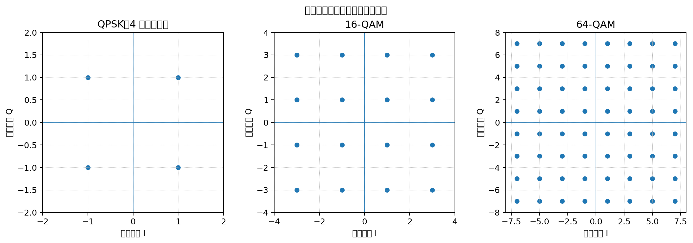
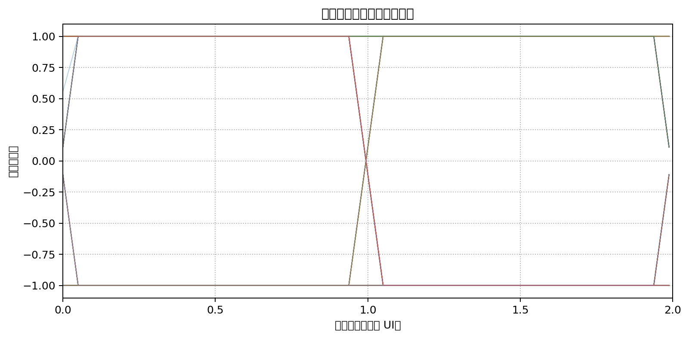
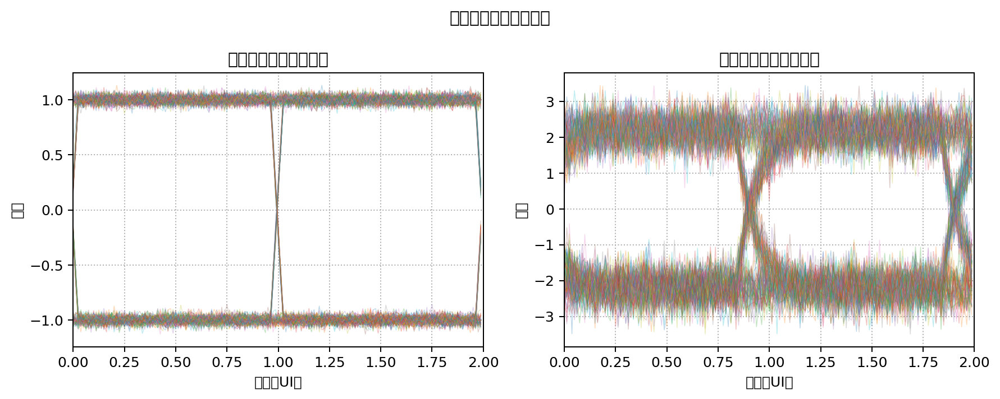

# 数字通信基础：香农公式、数字调制与眼图

本文整理了三个相关问题：

1. 为什么信噪比越大，信道容量越大？
2. 为什么高阶调制需要更好的信号质量？
3. 眼图是什么，应该怎么看？

---

## 一、香农公式：为什么信噪比越大，信道容量越大？

### 1. 香农公式是什么？

香农公式描述了在理想加性高斯白噪声（AWGN）信道中，给定带宽和信噪比时，理论上能够可靠传输信息的最大速率：

```text
C = B × log2(1 + SNR)
```

其中：

- C：信道容量，单位 bit/s。
- B：信道带宽，单位 Hz。
- SNR：信噪比，必须使用**线性功率比**，不能直接把 dB 数值代进去。

信噪比的定义是：

```text
SNR = Ps / Pn
```

其中 Ps 是信号功率，Pn 是噪声功率。

如果给出的是 dB：

```text
SNR_dB = 10 × log10(SNR)
```

反过来：

```text
SNR = 10^(SNR_dB / 10)
```

### 2. 为什么信噪比越大，容量越大？

接收端收到的信号可以理解为：

```text
接收信号 = 有用信号 + 噪声
```

噪声会让接收信号产生偏差。信噪比越高，意味着有用信号相对于噪声越强，接收端越容易区分不同的信号状态。

因此，在相同带宽下，系统可以采用更高效的调制和编码方式，或者在相同调制方式下实现更低的误码率，理论上可支持更高的信息速率。

注意：香农公式给出的是理想信道的理论上限，不代表实际设备一定能达到这个速率。

### 3. 一个简单例子

假设带宽 B=3000 Hz：

| 线性信噪比 SNR | 理论容量 |
|---:|---:|
| 1 | 3000 bit/s |
| 3 | 6000 bit/s |
| 7 | 9000 bit/s |
| 15 | 12000 bit/s |
| 31 | 15000 bit/s |

可以看到，信噪比提高时，信道容量也会提高，但二者不是简单的正比例关系，因为公式中有对数。

---

## 二、数字调制：为什么高阶调制需要更好的信号质量？

### 1. 什么是调制状态？

数字通信需要把 0 和 1 转换成可以在信道中传输的物理信号。

最简单的二进制传输可以使用两种不同状态：

- 状态 A 表示 0；
- 状态 B 表示 1。

每个符号（码元）只能携带 1 bit。

如果能够可靠地区分 4 种状态，就可以约定：

| 信号状态 | 对应数据 |
|---|---|
| 状态 1 | 00 |
| 状态 2 | 01 |
| 状态 3 | 10 |
| 状态 4 | 11 |

这样每个符号就能携带 2 bit。

一般来说，如果调制方式有 M 个可区分的状态，每个符号能够承载：

```text
log2(M) bit
```

当 M 是 2 的整数次幂时，可以直接按固定比特数分组。

### 2. QPSK、16QAM、64QAM 有什么区别？

| 调制方式 | 状态数量 | 每个符号携带的数据 |
|---|---:|---:|
| QPSK | 4 | 2 bit |
| 16QAM | 16 | 4 bit |
| 64QAM | 64 | 6 bit |
| 256QAM | 256 | 8 bit |

下面是不同调制方式的星座图示意。每个点代表一种可能发送的信号状态。



QPSK 的星座点比较稀疏，64QAM 的星座点更密集。星座点越密集，接收端越容易因为噪声、失真等因素把一个点判断成旁边的另一个点。

### 3. 为什么 64QAM 对信噪比要求更高？

可以把接收端想象成一个"分类器"：它要判断收到的信号最接近哪个星座点。

- QPSK：点之间距离较大，信号受到一定干扰后，通常仍然能判断正确。
- 64QAM：点之间距离较小，稍大的噪声就可能让接收点越过判决边界，造成误判。
- 256QAM：星座点更密集，通常还需要更高的信号质量。

因此，在目标误码率相同的情况下，高阶调制通常需要更高的信噪比。

### 4. 相同符号率下，高阶调制为什么速率更高？

比特率与符号率的关系为：

```text
Rb = Rs × log2(M)
```

其中：

- Rb：比特率，单位 bit/s。
- Rs：符号率，单位 symbol/s 或 Baud。
- M：调制状态数量。

假设符号率都是 1 Msymbol/s：

| 调制方式 | 每个符号携带比特数 | 理论比特率 |
|---|---:|---:|
| QPSK | 2 bit | 2 Mbit/s |
| 16QAM | 4 bit | 4 Mbit/s |
| 64QAM | 6 bit | 6 Mbit/s |
| 256QAM | 8 bit | 8 Mbit/s |

这里是未考虑信道编码、导频、帧头等开销的理想映射结果。

### 5. 实际无线通信如何选择调制方式？

Wi-Fi、4G、5G 等系统通常会根据当前信道质量动态调整调制与编码方式，这类机制通常称为自适应调制与编码（AMC，Adaptive Modulation and Coding）。

- 信号质量较差：使用 QPSK 等低阶调制，并可能使用更强的纠错编码，优先保证可靠性。
- 信号质量一般：使用 16QAM 等方式，在速率和可靠性之间折中。
- 信号质量较好：使用 64QAM、256QAM 等高阶调制，提高频谱效率和传输速率。

**核心规律：信道条件差时，降低调制阶数以提高可靠性；信道条件好时，提高调制阶数以提升传输效率。**

---

## 三、眼图：如何直观观察数字信号质量？

### 1. 眼图是什么？

眼图（Eye Diagram）是数字通信中用于观察信号质量的一种图形。

它的形成方式是：把接收端连续多个码元周期的波形，按照相同的时钟位置对齐并叠加显示。



叠加后的波形中间通常会出现一个类似眼睛的开口，因此称为"眼图"。

眼图不是某一个数据帧的单独波形，而是许多码元波形叠加后的观察结果。

### 2. 眼图怎么看？

主要关注以下几个方面：

| 观察项目 | 含义 | 一般判断 |
|---|---|---|
| 眼高 | 眼睛开口的垂直高度 | 越大，电压噪声容限通常越大 |
| 眼宽 | 眼睛开口的水平宽度 | 越大，采样时间容限通常越大 |
| 眼图闭合程度 | 波形受到噪声、码间干扰等影响的综合表现 | 越闭合，信号判决越困难 |
| 边沿抖动 | 信号跳变时刻的时间偏移 | 越小越好 |

### 3. 眼图开口大小意味着什么？



- 眼睛开口较大：通常表示噪声和码间干扰较小，接收端有较大的采样余量。
- 眼睛开口较小：通常表示噪声、码间干扰或抖动较明显，接收端更容易误判。
- 眼睛接近闭合：接收端很难找到可靠的采样时刻，误码风险较高。

### 4. 为什么眼图中间适合采样？

接收端需要在每个码元的特定时刻采样，然后判断当前码元代表 0 还是 1。

如果采样时刻靠近信号跳变边沿，稍微有一点时钟偏差或抖动，就可能采到错误的电平。

眼图开口最大的中间区域，通常具有更大的时间和电压容限，因此是比较理想的采样区域。

### 5. 眼图有什么工程用途？

在数字通信硬件调试中，眼图可以帮助工程师分析：

- 发送端波形是否失真；
- 接收端噪声是否过大；
- 码间干扰（ISI，Inter-Symbol Interference）是否严重；
- 时钟抖动是否过大；
- 接收端采样时刻是否合适。

---

## 四、把三个知识点串起来

这三个概念是有关联的：

1. **香农公式**：从理论上说明带宽和信噪比如何限制信道容量。
2. **数字调制**：通过增加可区分的信号状态，让每个符号携带更多 bit，从而提高频谱效率；但高阶调制对信号质量要求更高。
3. **眼图**：从接收波形的角度观察噪声、码间干扰和抖动等问题，判断信号是否容易被正确采样。

可以把它们概括为：

> 香农公式回答"理论上最多能传多快"；数字调制回答"如何让每个符号携带更多数据"；眼图帮助工程师观察"接收到的数字波形是否足够好，能否被可靠判决"。

## 五、几个容易混淆的概念

| 概念 | 重点 |
|---|---|
| 带宽（Hz） | 信道能够通过的频率范围 |
| 信噪比（SNR） | 有用信号功率与噪声功率之比 |
| 信道容量（bit/s） | 理想条件下可靠传输信息的理论上限 |
| 调制阶数（M） | 可以区分的信号状态数量 |
| 符号率（Baud） | 每秒发送多少个符号 |
| 比特率（bit/s） | 每秒传输多少 bit |
| 眼图 | 多个码元波形叠加后，用于观察信号质量的图形 |
