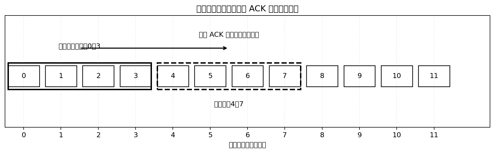
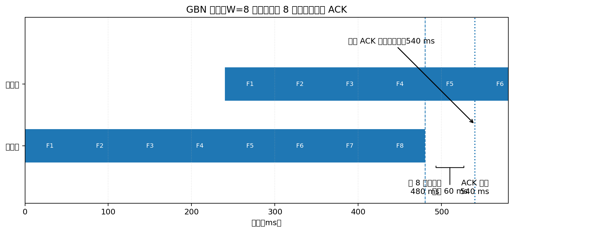

# 滑动窗口协议（Sliding Window Protocol）学习笔记

## 1. 为什么需要滑动窗口？

先想象一个最简单的可靠传输方式：**停止等待协议（Stop-and-Wait）**。

发送方发送一帧数据后，必须等接收方返回 ACK（确认）才能发送下一帧。

问题在于：如果通信链路很长，例如卫星链路，数据发送可能只需要几十毫秒，但 ACK 往返却需要几百毫秒。发送方大部分时间都在等待，链路利用率很低。

滑动窗口协议就是为了解决这个问题：

> 发送方不必每发送一帧就停下来等 ACK，而是可以在窗口允许的范围内，连续发送多帧数据。

这样就能利用发送后续帧的时间，覆盖前面数据帧在链路上传播、等待 ACK 的时间。

---

## 2. 什么是"窗口"？

窗口可以理解为：**发送方当前被允许连续发送、但还没有全部得到确认的数据帧范围。**

假设发送窗口大小 W=4，初始允许发送序号为 0、1、2、3 的四帧：

```text
发送窗口
┌────┬────┬────┬────┐
│  0 │  1 │  2 │  3 │  可以发送
└────┴────┴────┴────┘
```

发送方可以连续发送这四帧，不需要每发一帧就等待 ACK。

当接收方确认收到前面的帧后，发送窗口就可以向后移动。例如确认了 0、1 两帧，窗口向右滑动：

```text
原窗口： [0] [1] [2] [3]
新窗口：         [2] [3] [4] [5]
```

这就是"滑动窗口"名称的由来。



注意：

- 窗口大小决定发送方最多可以有多少帧处于"已发送但尚未确认"的状态。
- 窗口不是链路上额外的缓存空间，也不是在信道空闲时再放进去几个窗口。
- 发送方是在等待 ACK 的过程中，继续发送窗口内尚未发送的数据帧，以减少链路空闲时间。

---

## 3. 停止等待、GBN 和选择重传

常见的滑动窗口可靠传输协议有以下几类：

| 协议 | 发送窗口 | 出错后的处理 | 特点 |
|---|---:|---|---|
| 停止等待 | 1 | 重传当前帧 | 简单，但等待时间长 |
| GBN（回退 N 帧） | 大于等于 1 | 从出错帧开始，重传它及之后已发送的帧 | 接收方实现相对简单 |
| SR（选择重传） | 大于等于 1 | 只重传丢失或出错的帧 | 效率较高，但实现复杂 |

### 3.1 停止等待协议

```text
发送方                         接收方
  | -------- 数据帧 0 --------> |
  | <----------- ACK 0 -------- |
  | -------- 数据帧 1 --------> |
  | <----------- ACK 1 -------- |
```

发送一帧，等待一个 ACK，再发送下一帧。

### 3.2 GBN：Go-Back-N，回退 N 帧

GBN 允许发送方连续发送多个帧，但接收方通常只按序接收。

假设发送方连续发送：

```text
帧 0、帧 1、帧 2、帧 3、帧 4
```

如果帧 2 丢失：

- 接收方已经正确收到帧 0、帧 1。
- 接收方期待帧 2。
- 如果后面收到了帧 3、帧 4，因为它们不是当前期待的帧，GBN 接收方会丢弃它们。
- 发送方超时后，从帧 2 开始，把帧 2、帧 3、帧 4 重新发送。

因此叫"回退 N 帧"：发生错误后，发送方回退到出错帧，重新发送后续尚未确认的帧。

### 3.3 SR：Selective Repeat，选择重传

SR 允许接收方缓存乱序到达的正确帧。

例如帧 2 丢失，但帧 3、帧 4 到达：

- 接收方暂存帧 3、帧 4。
- 只要求发送方重传帧 2。
- 帧 2 到达后，再按顺序交付帧 2、帧 3、帧 4。

SR 减少了重复发送，但需要更多接收缓存和更复杂的确认管理。

---

## 4. 信道利用率为什么和窗口大小有关？

先定义两个时间：

- **Tf**：发送一帧数据所需要的时间，也叫帧发送时延。
- **Tp**：数据从发送端传播到接收端的单向传播时延。

在 ACK 传输时间和处理时间都忽略的理想情况下，GBN 的信道利用率为：

```text
U = min(1, W × Tf / (Tf + 2 × Tp))
```

其中：

- U：信道利用率，最大为 1，也就是 100%。
- W：发送窗口大小。
- Tf：一帧的发送时延。
- Tp：单向传播时延。

也可以写成：

```text
U = min(1, W / (1 + 2a))
```

其中：

```text
a = Tp / Tf
```

### 为什么分母是 Tf + 2×Tp？

从发送方开始发送第一帧的时刻算起：

1. 第一帧需要 Tf 才能发送完。
2. 数据再经过 Tp 到达接收方。
3. 接收方返回 ACK，ACK 再经过 Tp 回到发送方。

因此，第一帧的 ACK 回到发送方所经历的时间约为：

```text
Tf + 2 × Tp
```

在这段时间里，发送方最多可以连续发送 W 帧，总发送时间是：

```text
W × Tf
```

所以利用率是：

```text
U = 这段周期内实际发送数据的时间 / 等待确认的周期时间
  = W × Tf / (Tf + 2 × Tp)
```

但利用率不可能超过 100%，所以要加上 min(1, ...)。

**直观理解：窗口越大，发送方越能在等待 ACK 时继续发送后续帧，从而隐藏传播等待时间；但链路被连续占满后，利用率就已经是 100%，不可能再提高。**

---

## 5. 实际计算示例：卫星链路中窗口大小怎么算？

已知：

- 链路速率：200 kbps。
- 数据帧长度：1500 B。
- 单向传播时延：240 ms。
- 要求信道利用率不低于 80%。
- 忽略 ACK 发送时间和处理时间。

### 第一步：计算一帧的发送时延

1500 B 转换为 bit：

```text
1500 × 8 = 12000 bit
```

发送速率为 200 kbps，即 200000 bit/s：

```text
Tf = 12000 / 200000 = 0.06 s = 60 ms
```

### 第二步：计算往返传播时延

单向传播时延为 240 ms：

```text
2 × Tp = 2 × 240 = 480 ms
```

所以：

```text
Tf + 2 × Tp = 60 + 480 = 540 ms
```

### 第三步：代入利用率公式

```text
U = W × 60 / 540 = W / 9
```

要求利用率不低于 80%：

```text
W / 9 >= 0.8
W >= 7.2
```

窗口大小必须是整数，所以最小：

```text
W = 8
```

### 第四步：计算序号字段至少需要几位？

GBN 中，如果序号字段有 n 位，序号总数为：

```text
2^n
```

GBN 的发送窗口必须满足：

```text
W <= 2^n - 1
```

代入 W=8：

```text
8 <= 2^n - 1
2^n >= 9
```

所以最小 n=4，即序号字段至少需要 **4 bit**。

### 这个示例的时间过程

发送方连续发送 8 帧，每帧需要 60 ms：

```text
8 × 60 = 480 ms
```

第一帧的 ACK 在开始发送后约 540 ms 返回。因此发送方发送完 8 帧后，还需要等待约 60 ms，第一帧的 ACK 才回来。

```text
U = 480 / 540 ≈ 88.9%
```



这也说明：窗口大小为 8 时，链路并非完全没有空闲时间，但利用率已经达到约 88.9%，满足 80% 的要求。

---

## 6. GBN 的序号为什么要满足 W <= 2^n - 1？

假设序号字段只有 3 bit：

```text
2^3 = 8
```

序号只能是：

```text
0、1、2、3、4、5、6、7
```

之后重新从 0 开始，这叫序号回绕。

GBN 中，发送窗口最大不能达到整个序号空间大小，否则可能出现新旧帧序号混淆。

因此：

```text
W_max = 2^n - 1
```

例如：

| 序号位数 n | 序号总数 | GBN 最大窗口 |
|---:|---:|---:|
| 1 | 2 | 1 |
| 2 | 4 | 3 |
| 3 | 8 | 7 |
| 4 | 16 | 15 |
| 5 | 32 | 31 |

补充：选择重传 SR 对序号空间的要求更严格，通常需要：

```text
W <= 2^(n-1)
```

这是为了避免序号回绕后，新帧与仍可能存在的旧帧混淆。

---

## 7. TCP 里的滑动窗口和 GBN 是一回事吗？

**它们都使用滑动窗口思想，但不是同一个协议。**

### TCP 的窗口主要解决两个问题

1. **流量控制**：接收方通过接收窗口 `rwnd` 告诉发送方，自己还有多少接收缓存空间。
2. **拥塞控制**：发送方通过拥塞窗口 `cwnd` 限制注入网络的数据量，避免网络过载。

TCP 发送方实际允许在途的数据量通常受以下关系限制：

```text
发送窗口上限 = min(rwnd, cwnd)
```

其中：

- `rwnd`：接收方通告的接收窗口，保护接收方。
- `cwnd`：发送方维护的拥塞窗口，保护网络。

TCP 是按字节序号管理窗口，而教材中的 GBN 通常按数据帧序号管理窗口。TCP 也有自己的重传、累计确认、选择确认（SACK）等机制，不能简单地把 TCP 等同于 GBN。

---

## 8. 核心公式速查

### 常用公式

**GBN 信道利用率：**

```text
U = min(1, W × Tf / (Tf + 2 × Tp))
```

**帧发送时延：**

```text
Tf = 帧长度（bit） / 链路速率（bit/s）
```

**GBN 序号位数约束：**

```text
W <= 2^n - 1
```

**SR 序号位数约束：**

```text
W <= 2^(n-1)
```

### 计算步骤

1. 把帧长度统一换算成 bit。
2. 用帧长度除以链路速率，求 Tf。
3. 明确给出的是单向传播时延还是往返传播时延。
4. 代入利用率公式，求最小窗口大小 W。
5. 根据协议类型，使用对应的序号空间约束，求最少序号位数。

### 常见误区

- 单向传播时延是 Tp，往返传播时延是 2×Tp。
- 帧发送时延 Tf 和传播时延 Tp 不是一回事。
- 窗口大小 W 表示最多允许多少帧处于已发送但未确认状态。
- 增大窗口是为了覆盖等待 ACK 的时间，不是为了突破链路本身的物理速率。
- 利用率最大为 100%，所以公式要取 min(1, ...)。
- GBN 和 SR 的序号位数约束不同，不能混用。
