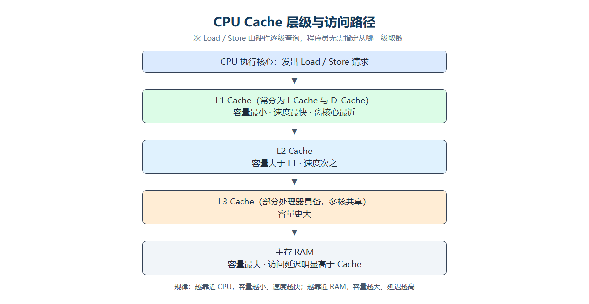
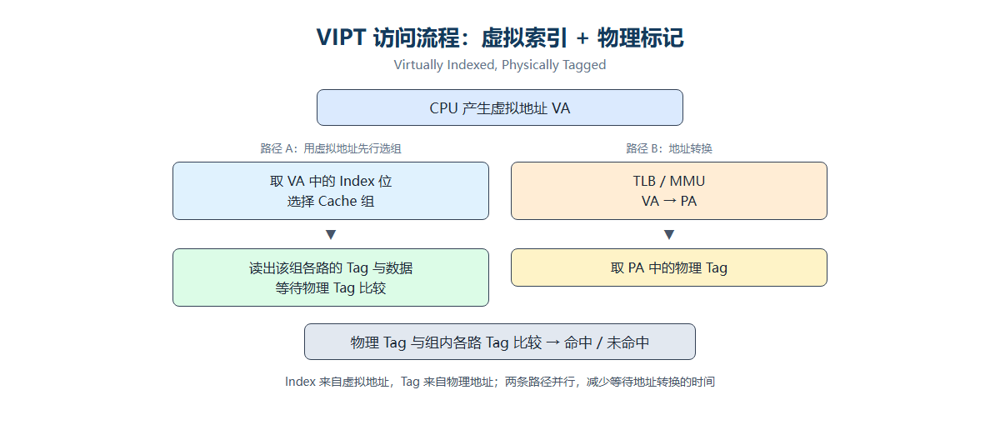
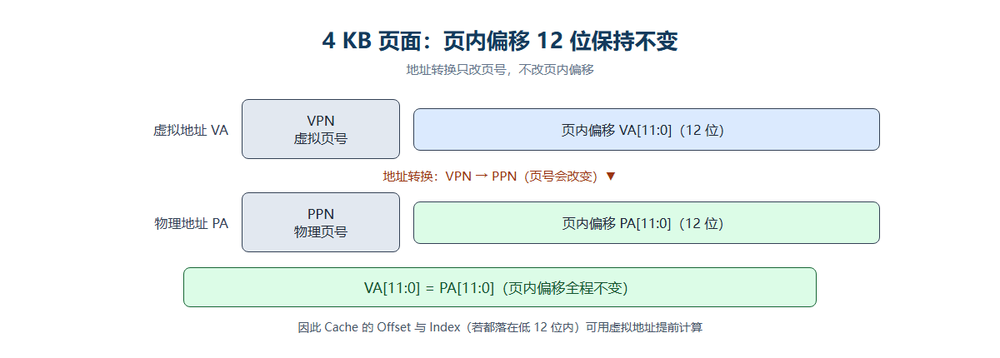
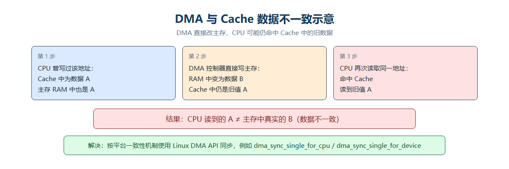

# CPU Cache、VIPT 与 Cache Miss 工作机制

> 本文梳理 CPU Cache 的分层结构、VIPT（虚拟索引、物理标记）的地址划分与容量约束、Index 超出或不足页内偏移范围时的处理方式，以及 Cache Miss 的硬件行为、内存属性（Memory Attributes）与 Cache Index 的区别。

## 1. Cache 是什么：硬件自动管理的高速缓存

Cache（高速缓存）通常集成在 CPU 或处理器 SoC 内部，用于暂存近期或可能再次访问的数据和指令。它的访问速度通常快于主存 RAM。

常见层级：

- **L1 Cache**：距离执行核心最近，容量较小、速度快。通常分为指令缓存 I-Cache 和数据缓存 D-Cache。
- **L2 Cache**：容量通常大于 L1，速度通常慢于 L1。
- **L3 Cache**：部分处理器具有，通常容量更大，可能由多个核心共享。
- **RAM**：主存，容量较大，但访问延迟通常明显高于 Cache。

Cache 的存储阵列、索引、Tag 比较、命中判断和替换等主要由硬件实现。普通程序不需要编写“读取 L1”“读取 L2”这样的指令。



## 2. CPU 访问数据时，程序员写了什么？

例如 C 代码：

```c
int a = array[10];
```

编译器可能将其转换为类似 ARM `LDR` 的加载指令。该指令表达的是：

> 从某个地址读取数据，并将结果放入寄存器。

它通常不会指定数据必须来自 L1、L2、L3 或 RAM。CPU 硬件会根据地址自动查询缓存层级，并在需要时向下一级获取数据。

因此可以区分三个角色：

| 层次 | 主要职责 |
| --- | --- |
| 程序员 | 编写对变量或内存地址的读写操作 |
| 编译器 | 将程序转换成机器指令，例如 Load / Store |
| CPU 硬件 | 自动完成地址转换、Cache 查询、命中判断和缺失处理 |

## 3. VIPT：虚拟索引、物理标记

VIPT 全称 **Virtually Indexed, Physically Tagged**：

- **Virtually Indexed**：使用虚拟地址中的 Index 位选择 Cache 组。
- **Physically Tagged**：使用地址转换得到的物理地址 Tag 判断是否命中。

它的关键思想是：**Cache 组索引与虚拟地址到物理地址的转换可以并行进行**，减少地址转换对 Cache 查询的等待。



### 3.1 Index 和 Tag 分别做什么？

- **Index（组索引）**：决定去 Cache 的哪一组查找。
- **Tag（标记）**：在选中的组内，判断哪条 Cache Line 对应目标物理地址。
- **Offset（块内偏移）**：确定 Cache Line 内部具体的字节或数据位置。

以一个示例 Cache 为例：

| 参数 | 取值 |
| --- | --- |
| Cache 容量 | 32 KB |
| Cache Line | 64 B |
| 组相联度 | 8 路 |

计算总行数、组数与地址位宽：

```text
总行数 = Cache 容量 / Cache Line 大小
       = 32 KB / 64 B
       = 32 × 1024 / 64
       = 512 行

组数   = 总行数 / 组相联度
       = 512 / 8
       = 64 组

Offset 位数 = log2(Cache Line 大小)
            = log2(64)
            = 6 位

Index 位数  = log2(组数)
            = log2(64)
            = 6 位
```

地址划分可表示为：

| 字段 | 位数 | 作用 |
| --- | --- | --- |
| Tag | 剩余高位 | 比较物理地址标记 |
| Index | 6 位 | 选择 64 组中的一组 |
| Offset | 6 位 | 选择 64 B Cache Line 内的位置 |

### 3.2 为什么虚拟地址可以提前提供 Index？

常见系统使用分页机制。若页面大小为 4 KB：

```text
4 KB = 2^12 B
```

因此，页内偏移是地址的低 12 位，即 `VA[11:0]`。

地址转换会把虚拟页号 VPN 转换为物理页号 PPN，但**页内偏移保持不变**：

```text
VA[11:0] = PA[11:0]
```



在上面的 Cache 示例中：

- Offset 使用低 6 位：`[5:0]`。
- Index 使用接下来的 6 位：`[11:6]`。

Index 和 Offset 都位于 4 KB 页面内的低 12 位中。因此，CPU 可以直接使用虚拟地址的 `[11:6]` 选择 Cache 组，同时由 TLB / MMU 完成地址转换。得到物理地址后，再使用物理 Tag 比较。

### 3.3 VIPT 的一次访问过程

1. CPU 产生虚拟地址 VA。
2. 一条路径使用 VA 的 Index 选择 Cache 组。
3. 另一条路径通过 TLB / MMU 将 VA 转换为 PA。
4. 从 PA 中取得物理 Tag。
5. 将物理 Tag 与选中 Cache 组内各路保存的 Tag 比较。
6. 找到匹配项则 Cache Hit；没有匹配项则 Cache Miss。

对于 8 路组相联 Cache，选中一组后，需要比较该组中最多 8 个 Tag。

### 3.4 VIPT 的容量限制

为了让所有 Index 位都落在页内偏移中，常见 VIPT 设计需要满足：

```text
Cache 容量 / 路数 ≤ 页面大小
```

也可以写成：

```text
组数 × Cache Line 大小 ≤ 页面大小
```

例如 32 KB、8 路组相联的 Cache：

```text
32 KB / 8 = 4 KB
```

当页面大小为 4 KB 时，满足这一条件。这样 Index 所需的位都可以从页内偏移中取得。

### 3.5 如果 Index 超出页内偏移范围，会怎样？

上面的条件是"刚好够用"的情形。一旦容量继续增大，约束就会被打破，问题从容量设计变成地址别名。

取一组具体参数：页面 4 KB、Cache Line 64 B、Cache 64 KB、8 路组相联。

```text
总行数 = 64 KB / 64 B
       = 1024 行

组数   = 1024 / 8
       = 128 组

Index 位数 = log2(128)
           = 7 位

Offset 位数 = log2(64)
            = 6 位
```

地址划分变为：

| 字段 | 位数 | 位区间 |
| --- | --- | --- |
| Tag | 剩余高位 | 13 位及以上 |
| Index | 7 位 | VA[12:6] |
| Offset | 6 位 | VA[5:0] |

页内偏移只有 `VA[11:0]`，而 Index 已经用到了 `VA[12]`。`VA[12]` 属于虚拟页号 VPN 的一部分，地址转换后可能改变：

```text
VA[12] ≠ PA[12]
```

于是同一块物理内存，通过两个不同的虚拟地址访问时，可能被索引到不同的 Cache 组，这就是 **Cache Aliasing（缓存别名）**。若不加处理，同一物理地址可能在 Cache 中存在两份副本，写其中一份、另一份就变成旧数据。

解决办法有三类。

**方案一：增加路数，减少组数**

约束式仍然是：

```text
Cache 容量 / 路数 ≤ 页面大小
```

等价于：

```text
组数 × Cache Line 大小 ≤ 页面大小
```

以 4 KB 页面为例：

| Cache 容量 | 路数 | 每路容量 | 是否满足 |
| --- | --- | --- | --- |
| 32 KB | 8 | 4 KB | 满足（Index 6 位） |
| 64 KB | 8 | 8 KB | 不满足（Index 7 位） |
| 64 KB | 16 | 4 KB | 满足（Index 6 位） |
| 128 KB | 32 | 4 KB | 满足（Index 6 位） |

路数翻倍，组数就减半，Index 少一位，重新落回页内偏移。64 KB 用 8 路需要 7 位 Index，不满足；改成 16 路只剩 64 组，6 位 Index 即可满足。这是最直观的做法，代价是相联度提高、比较逻辑变复杂。

**方案二：改用 PIPT**

先由 MMU 把虚拟地址转成物理地址，再用物理地址的 Index 选组、物理 Tag 比较。索引不再来自虚拟地址，别名问题从根上消失。

代价是 Cache 索引必须等地址转换完成，VIPT "在转换完成前先选组"的并行优势没有了，访问延迟增加。

**方案三：由硬件处理别名**

在 Cache 或总线层面检测"不同虚拟地址映射到同一物理页"的情况，必要时做同步或失效，或采用特殊的索引/标签设计避免错误命中。功能上可行，但硬件设计复杂度明显提高。

归纳：优先用增加路数把 Index 压回页内偏移；容量需求超出约束时改用 PIPT；也可以由硬件承担别名处理。

### 3.6 如果 Index 小于页内偏移范围，会不会有地址读不到 Cache？

不会。Index 比页内偏移"短"，只是没有用满页内的位，地址照样能正常访问 Cache。

换一组参数：页面 4 KB、Cache Line 64 B、Cache 16 KB、8 路组相联。

```text
总行数 = 16 KB / 64 B
       = 256 行

组数   = 256 / 8
       = 32 组

Index 位数 = log2(32)
           = 5 位

Offset 位数 = log2(64)
            = 6 位
```

地址划分：

| 字段 | 位数 | 位区间 |
| --- | --- | --- |
| Offset | 6 位 | VA[5:0] |
| Index | 5 位 | VA[10:6] |
| 未参与索引 | 1 位 | VA[11] |

`VA[11]` 既不参与组索引，也不参与块内偏移，但它仍然是地址的一部分。例如 `0x00000000` 与 `0x00000800` 的低 11 位相同，会落在同一组的同一行内位置，但两者转换后的 Tag 不同，可以分别存放在该组的不同路中——只要 Tag 比较通过，地址就正常命中。

约束核对：

```text
Index + Offset = 5 + 6
               = 11 位

11 位 ≤ 12 位（页内偏移）
```

完全满足 VIPT 约束。三种情况对照：

| Index + Offset 与页内偏移 | 是否正常 | 原因 |
| --- | --- | --- |
| 小于 | 正常 | 部分页内位不参与索引 |
| 等于 | 正常 | 刚好用满页内偏移 |
| 大于 | 需要处理 | 索引用到 VPN 位，可能产生别名 |

一句话记忆：**VIPT 关心的是 Index 有没有超出页内偏移，而不是有没有用满页内偏移。**

## 4. Cache Hit 和 Cache Miss：耗时为什么不同？

- **Cache Hit（命中）**：所需数据已经在当前 Cache 层级中，可以直接返回。
- **Cache Miss（未命中）**：当前层级没有所需数据，需要向下一级缓存或主存请求数据。

通常访问层级越靠近 CPU，延迟越低；越靠近 RAM，延迟越高。具体延迟取决于处理器型号、频率、缓存结构、内存类型和访问状态，不存在适用于所有 CPU 的固定数值。

## 5. Cache Miss 时，CPU 会不会停下来？

发生 Cache Miss 后，相关 Load 指令需要等待数据返回。依赖该数据的后续指令也无法得到正确输入。

例如：

```c
int a = array[0];  // 假设发生 Cache Miss
int b = a + 10;    // 依赖 a，必须等待
int c = 100 + 200; // 不依赖 a，可能先执行
int d = c * 2;     // 依赖 c，可能先执行
```

现代高性能 CPU 通常支持乱序执行（Out-of-Order Execution）。当 `a` 尚未返回时，CPU 可能先执行与 `a` 无关的指令，例如计算 `c` 和 `d`。

因此，Cache Miss 不一定让整个 CPU 完全停止：

- 依赖缺失数据的指令需要等待。
- 不依赖该数据的指令可能继续执行。
- 如果没有足够的独立指令，执行流水线就可能出现停顿。
- 数据返回后，等待该数据的指令才能继续推进。

CPU 还可能使用 MSHR（Miss Status Holding Register）等硬件结构记录未完成的缓存缺失请求，并支持多个未完成访问。

## 6. Cache Miss 时，谁负责访问 L2、L3 和 RAM？

这是 CPU 硬件自动完成的，不是程序员写多条指令依次读取 L2、L3。

程序中的：

```c
int a = array[10];
```

会被编译成 Load 类指令。CPU 执行这条指令时，缓存层级硬件会根据处理器微架构处理查询和缺失请求。


需要注意：实际处理器的缓存查询方式不一定是严格串行的“先 L1、再 L2、再 L3”。不同微架构可能采用并行查询、非阻塞缓存、预取等优化。上图只是帮助理解的简化模型。

## 7. 程序员和驱动能否操作 Cache？

普通程序的 Load / Store 操作通常不需要程序员手动指定 Cache 层级。Cache 对普通程序员基本是透明的。

但在一些特殊场景中，软件需要执行 Cache 维护或同步操作。

### 7.1 Cache 维护指令

处理器架构可能提供 Clean、Invalidate 等维护操作。例如部分 ARM 架构提供：

```asm
DC CIVAC, X0
DC CVAC, X0
DC IVAC, X0
```

这些是 Cache 维护指令，不是日常读取数据时用来选择 L1、L2 的指令。具体指令名称、适用范围和权限取决于处理器架构版本。

### 7.2 DMA 与 Cache 一致性

DMA 控制器可以直接读写内存。如果 CPU Cache 与 DMA 不具备硬件一致性，可能出现：

1. CPU Cache 中保存着旧数据 A。
2. DMA 将主存中的数据更新为 B。
3. CPU 再次读取时，可能命中 Cache 中的旧数据 A。



因此，Linux 驱动需要正确使用 DMA API，例如：

```c
dma_alloc_coherent();
dma_map_single();
dma_unmap_single();
dma_sync_single_for_cpu();
dma_sync_single_for_device();
```

这些接口负责按照平台 DMA 一致性机制和映射类型执行必要的同步。使用一致性 DMA 内存与流式 DMA 映射时，具体要求不同，应遵循 Linux DMA API 的所有权和同步规则。

## 8. 三种常见 Cache 地址设计

| 类型 | Index 使用 | Tag 使用 |
| --- | --- | --- |
| VIVT | 虚拟地址 | 虚拟地址 |
| PIPT | 物理地址 | 物理地址 |
| VIPT | 虚拟地址 | 物理地址 |

- **VIVT**：虚拟地址索引、虚拟地址标记。查询可以较早开始，但需要处理虚拟地址别名等问题。
- **PIPT**：物理地址索引、物理地址标记。通常需要先获得物理地址再完成索引。
- **VIPT**：虚拟地址索引、物理地址标记。利用页内偏移在地址转换前选择 Cache 组，再用物理 Tag 确认数据身份。

## 9. 内存属性（Memory Attributes）与 Cache Index 的区别

一个常见误解是：以为"低地址用 Cache、高地址不用 Cache"，或者以为某个地址位没参与 Index 就意味着这个地址不走 Cache。两种理解都不对。

真正决定"这次访存能不能用 Cache"的，是页表项里配置的**内存属性（Memory Attributes）**，而不是地址的高低。

以 ARM 为例，Linux 打开 MMU 后，虚拟地址经页表映射到物理地址，页表项（PTE）中同时配置了内存属性。常见三类：

| 内存属性 | 含义 | 是否使用普通数据 Cache |
| --- | --- | --- |
| Normal Cacheable | 普通可缓存内存 | 使用 |
| Normal Non-cacheable | 普通不可缓存内存 | 不使用普通数据 Cache |
| Device | 设备内存 | 不使用，采用设备访问语义 |

示意性映射（仅说明机制，并非某颗 ARM 芯片的真实内存布局）：

```text
0x80000000 ~ 0x80FFFFFF   Normal Cacheable       允许使用 Cache
0x90000000 ~ 0x900FFFFF   Normal Non-cacheable   绕过普通数据 Cache
0xA0000000 ~ 0xA000FFFF   Device                 外设寄存器等设备访问
```

看起来像是按地址段划分，但这只是某套内存映射方案的结果，并不是架构规定。属性由页表按页配置，因此：

- 可缓存与不可缓存的区域不要求按连续地址整齐排列，相邻页可以有不同属性；
- 不存在"低地址必须可缓存、高地址必须不可缓存"的规则；
- 同一物理页一般不应建立属性不兼容的多个别名映射，否则行为不确定。

再看它与 Cache Index 的区别：

| 概念 | 由谁决定 | 作用 |
| --- | --- | --- |
| Cache Index | Cache 硬件组织（容量、行大小、路数） | 决定数据放在 Cache 的哪一组 |
| Memory Attributes | MMU 页表项配置 | 决定这次访问是否允许使用 Cache |

用 3.6 的例子说明：`VA[11]` 没有参与 Index，但只要该地址对应的页表项配置为 Normal Cacheable，访问照样走 Cache。**"某位没参与索引"与"该地址不能用 Cache"是两件互不相干的事。**

## 10. 核心结论

1. Cache 的存储、查询、命中判断和缺失处理主要由 CPU 硬件实现。
2. 普通程序只发出内存读写请求，不需要编写读取 L1、L2、L3 的指令。
3. Cache Hit 通常较快；Cache Miss 需要从更低层级获取数据，相关指令可能等待。
4. 现代 CPU 可以利用乱序执行、预取和非阻塞缓存等机制隐藏部分等待延迟。
5. VIPT 的核心是：**用虚拟地址提前选择 Cache 组，同时进行地址转换，最后用物理地址 Tag 判断是否命中。**
6. Linux 内核和驱动通常不负责实现 Cache 本身，但在 DMA 等场景中需要正确处理 Cache 一致性。
7. VIPT 只要求 `Index + Offset` 不超过页内偏移：超出时用增加路数、改用 PIPT 或硬件别名处理；没超出（包括小于）都能正常工作。
8. 是否使用 Cache 由页表内存属性（Memory Attributes）决定，与 Cache Index 无关，不能按地址高低推断某段内存是否可缓存。
