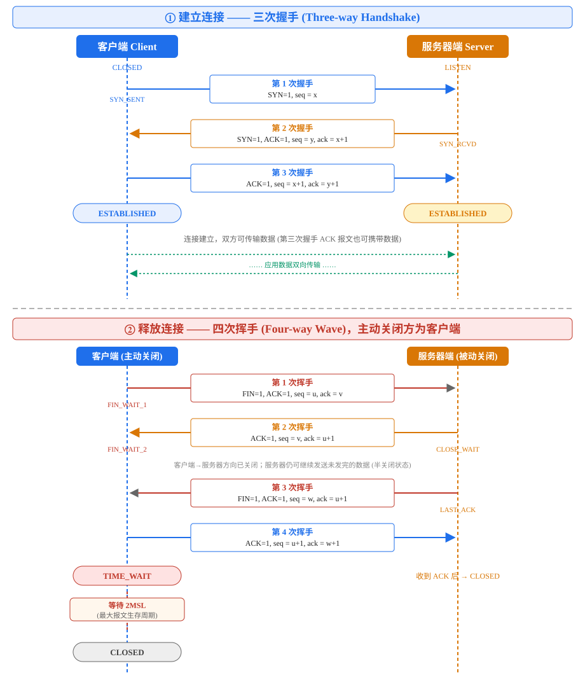
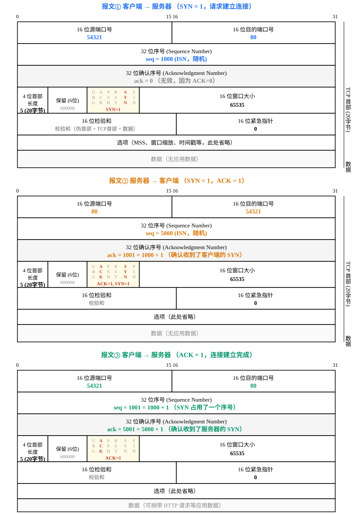
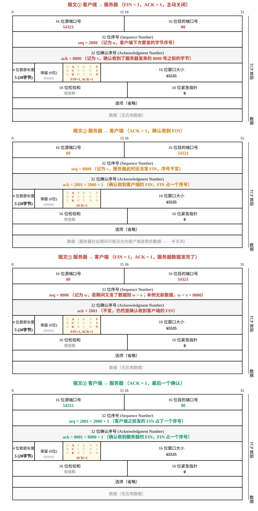
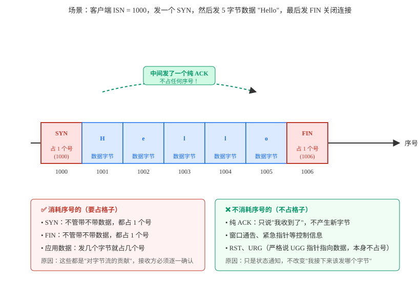
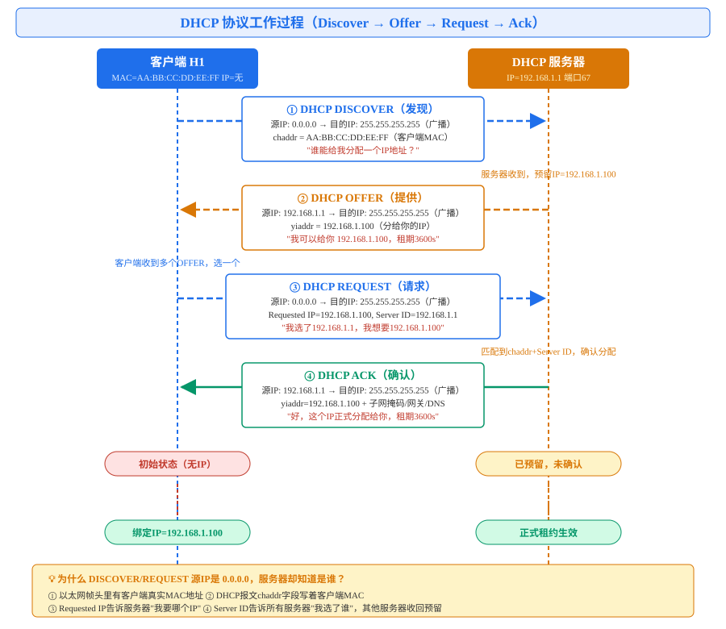

# TCP 三次握手与四次挥手 笔记

> 408 计算机学科专业基础 / 计算机网络 高频考点
> 包含：协议时序图、报文首部逐字段图解、实际抓包示例、序号消耗规则

---

## 一、整体时序图

下图完整展示了 TCP 建立连接（三次握手）和释放连接（四次挥手）的全过程，包括每个报文的标志位、`seq`、`ack` 值，以及两端的状态变迁。



---

## 二、三次握手（建立连接）

### 2.1 场景设定

- 客户端 IP：`192.168.1.100`，临时端口 `54321`
- 服务器 IP：`93.184.216.34`，端口 `80`（HTTP）
- 客户端初始序号 ISN(c) = `1000`，服务器初始序号 ISN(s) = `5000`

### 2.2 三个报文首部格式（谢希仁教材样式）



### 2.3 三个报文核心字段速查

| 报文 | 方向 | 标志位 | seq | ack | 含义 |
|---|---|---|---|---|---|
| ① | C → S | SYN=1 | 1000 | 0（无效） | "我想连，我的ISN是1000" |
| ② | S → C | SYN=1, ACK=1 | 5000 | 1001 = 1000+1 | "收到了，同意连，我的ISN是5000" |
| ③ | C → S | ACK=1 | 1001 = 1000+1 | 5001 = 5000+1 | "收到你的ISN，连接建立完成" |

### 2.4 TCP 标志位字节（第13个字节）速查

从低位到高位：`bit0=FIN, bit1=SYN, bit2=RST, bit3=PSH, bit4=ACK, bit5=URG`

- 报文① SYN ：`00000010` = **0x02**
- 报文② SYN+ACK：`00010010` = **0x12**
- 报文③ ACK：`00010000` = **0x10**

---

## 三、四次挥手（释放连接）

### 3.1 场景设定

假设数据传输阶段：
- 客户端最后发送的字节序号 `u = 2000`
- 服务器最后发送的字节序号 `v = 8000`
- 主动关闭方为客户端

### 3.2 四个报文首部格式（谢希仁教材样式）



### 3.3 四个报文核心字段速查

| 报文 | 方向 | 标志位 | seq | ack | 含义 |
|---|---|---|---|---|---|
| ① | C → S | FIN=1, ACK=1 | 2000 (u) | 8000 (v) | "我数据发完了，请求关闭" |
| ② | S → C | ACK=1 | 8000 (v) | 2001 = u+1 | "收到你的FIN"（服务器可能还有数据要发） |
| ③ | S → C | FIN=1, ACK=1 | 8000 (w) | 2001 = u+1 | "我也数据发完了" |
| ④ | C → S | ACK=1 | 2001 = u+1 | 8001 = w+1 | "收到你的FIN，再见"（TIME_WAIT 2MSL） |

---

## 四、为什么有的消耗序号，有的不消耗？

核心一句话：**序号是给"字节"编号的，不是给"报文"编号的。**

SYN 和 FIN 虽然不带应用数据，但它们是"需要被确认的特殊事件"，所以要借一个字节的位置；纯 ACK 只是个"收到了"的回执通知，不产生新字节，所以不占号。



### 4.1 消耗序号的

- **SYN**：不管带不带数据，都占 1 个号
- **FIN**：不管带不带数据，都占 1 个号
- **应用数据**：发几个字节就占几个号

原因：这些都是"对字节流的贡献"，接收方必须逐一确认。

### 4.2 不消耗序号的

- **纯 ACK**：只说"我收到了"，不产生新字节
- **窗口通告、紧急指针**等控制信息
- **RST** 复位报文

原因：只是状态通知，不改变"我接下来该发哪个字节"。

### 4.3 做题口诀

```
ACK 不占号，SYN/FIN 各占 1 号，数据几个字节就占几个号。
```

序号计数器只在"真正往外发了东西"的时候才往前走——发数据走 N 步，发 SYN/FIN 走 1 步，发纯 ACK 原地不动。

---

## 五、408 高频考点

### 5.1 为什么是三次握手？

防止已失效的连接请求报文突然到达服务器，导致服务器误以为客户端要建立连接而空等，浪费资源；同时双方都要确认对方的发送和接收能力正常。

### 5.2 为什么握手是 3 次、挥手是 4 次？

服务器收到客户端 FIN 后，可能还有数据未发完，所以先回 ACK 确认，等数据发完后再单独发 FIN，ACK 与 FIN 不能合并。

### 5.3 TIME_WAIT 为什么要等 2MSL？

1. 保证最后一个 ACK 能到达服务器（若丢失，服务器会重发 FIN，客户端可重发 ACK）
2. 让本连接持续时间内产生的所有报文段都从网络中消失，避免旧连接的报文污染新连接

### 5.4 seq 与 ack 的关系

```
ack = 对方的 seq + 1
```

（SYN、FIN 各占用一个序号，即使没有数据。）

### 5.5 三次握手状态变迁

- 客户端：CLOSED → SYN_SENT → ESTABLISHED
- 服务器：LISTEN → SYN_RCVD → ESTABLISHED

### 5.6 四次挥手状态变迁

- 客户端：ESTABLISHED → FIN_WAIT_1 → FIN_WAIT_2 → TIME_WAIT → CLOSED（等 2MSL）
- 服务器：ESTABLISHED → CLOSE_WAIT → LAST_ACK → CLOSED

---

## 六、DHCP 协议工作过程（补充）

> 虽然 DHCP 基于 UDP（不是 TCP），但同样是 408 高频考点，一起放在这里。

### 6.1 问题：主机刚接入网络，怎么知道自己的 IP？

主机出厂时只有网卡 MAC 地址，没有 IP。它怎么知道自己该用什么 IP、网关是谁、DNS 是多少？——这就是 DHCP（动态主机配置协议）要解决的事。

### 6.2 四个阶段时序图



### 6.3 四个报文核心字段

| 报文 | 方向 | 源IP | 目的IP | 关键字段 | 含义 |
|---|---|---|---|---|---|
| ① DISCOVER | C→S 广播 | 0.0.0.0 | 255.255.255.255 | chaddr=客户端MAC | "谁能给我分个IP？" |
| ② OFFER | S→C 广播 | 192.168.1.1 | 255.255.255.255 | yiaddr=192.168.1.100 | "我可以给你这个IP" |
| ③ REQUEST | C→S 广播 | 0.0.0.0 | 255.255.255.255 | Requested IP + Server ID | "我选了你，我要这个IP" |
| ④ ACK | S→C 广播 | 192.168.1.1 | 255.255.255.255 | yiaddr + 子网掩码/网关/DNS | "正式分配，租期X秒" |

### 6.4 为什么源IP是 0.0.0.0，服务器却知道是谁？

这是最容易考的点。虽然 IP 层源地址是 `0.0.0.0`（我还没IP），但服务器通过三个途径识别客户端：

1. **以太网帧头的源MAC地址**：最外层就写着客户端网卡的真实MAC，服务器网卡直接看到。
2. **DHCP 报文中的 `chaddr` 字段**：明文写着客户端MAC地址。
3. **options 里的两个关键选项**：
   - `Requested IP Address`：告诉服务器"我想要你之前分给我的那个IP"
   - `Server Identifier`：广播告诉所有DHCP服务器"我选了你这台"，其他服务器收到后会收回预留的IP。

### 6.5 DHCP 端口号

- 客户端：UDP 端口 **68**
- 服务器：UDP 端口 **67**

### 6.6 为什么全程广播？

因为客户端一开始没有IP，单播给服务器它也不知道服务器在哪；而且可能有多台DHCP服务器，广播让所有服务器都收到 DISCOVER，客户端再从中选一个最合适的 OFFER。

---

## 七、文件说明

```
11-其他/
├── tcp握手协议.md                         # 本文档（TCP + DHCP）
└── images/                                # 图片资源
    ├── tcp-handshake-wave-sequence.svg    # TCP 握手+挥手整体时序图
    ├── tcp-three-way-handshake-header.svg # 三次握手三个报文首部格式
    ├── tcp-four-way-wave-header.svg       # 四次挥手四个报文首部格式
    ├── tcp-seq-number-consumption.svg    # TCP 序号消耗规则图解
    └── dhcp-process.svg                   # DHCP 四阶段工作过程图
```
